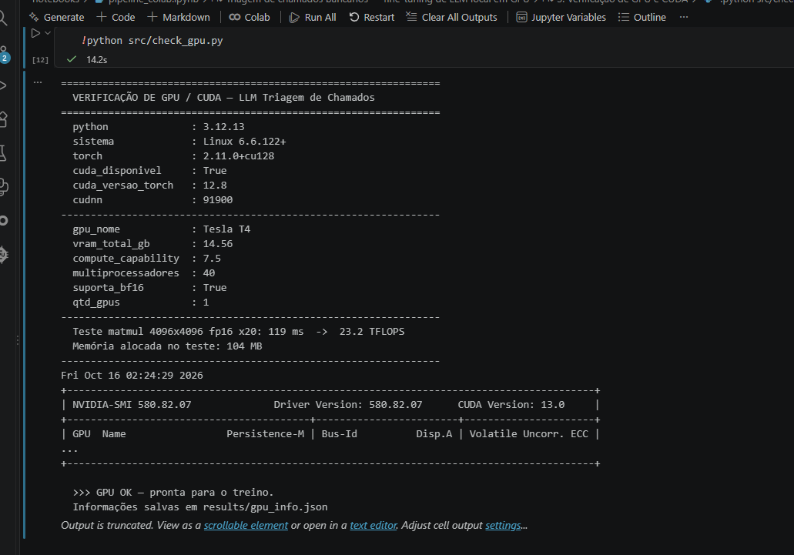
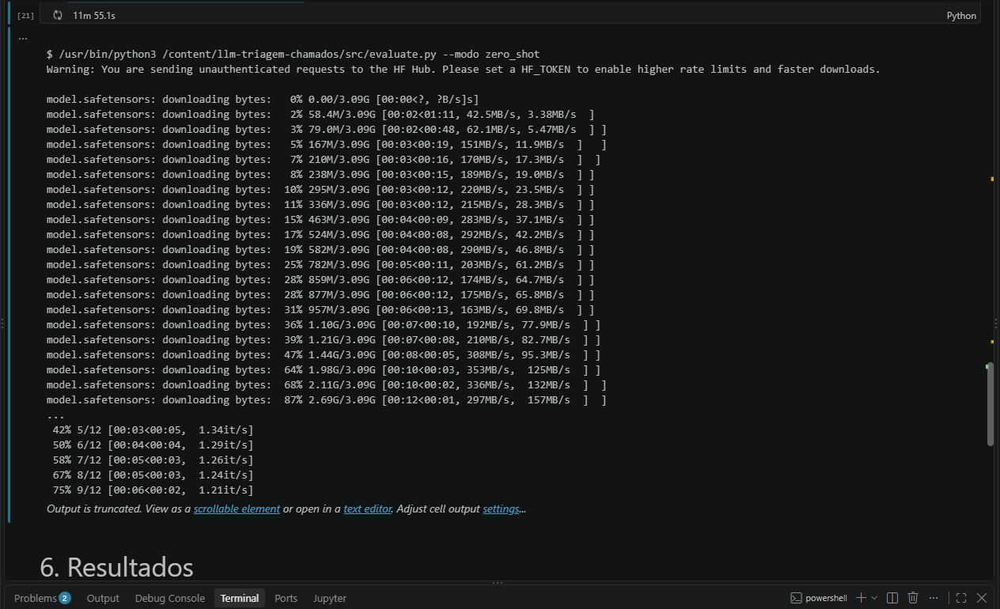
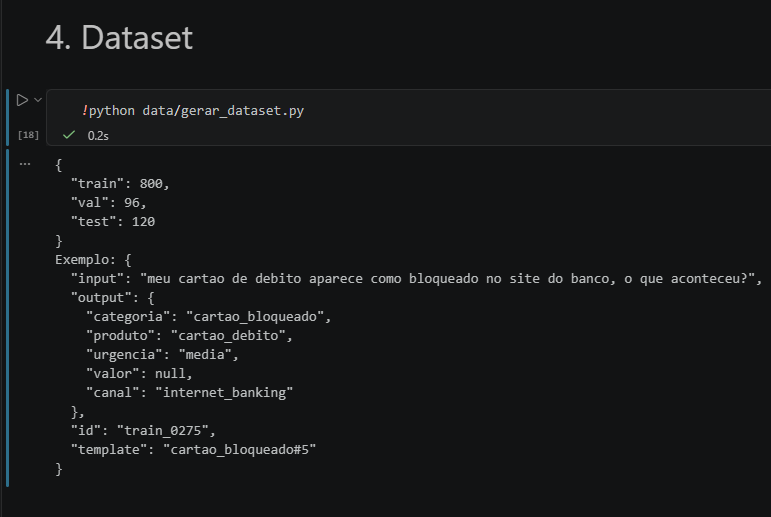
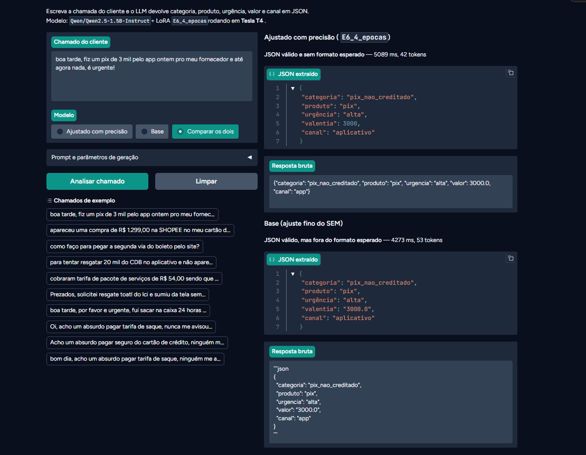

# Triagem de chamados bancários com LLM local (fine-tuning LoRA/QLoRA em GPU)

Fine-tuning de uma LLM local (**Qwen2.5-1.5B-Instruct**) para ler o relato livre de um cliente de banco e devolver um **JSON estruturado** com categoria, produto, urgência, valor e canal. Todo o treino e avaliação rodam em **GPU NVIDIA com CUDA**, com frontend em Gradio para o usuário escrever o prompt.

**Resultado principal:** o melhor modelo fine-tuned acerta os 5 campos do JSON em **88,3%** dos chamados de teste, contra **1,7%** do mesmo modelo sem treino, com 8,5 minutos de treino numa GPU Tesla T4.

## Integrantes

| Nome | RM |
|---|---|
| Gustavo Bonfim | RM98864 |


## Sumário

1. [Problema escolhido](#1-problema-escolhido)
2. [Escolha da LLM](#2-escolha-da-llm)
3. [Dataset](#3-dataset)
4. [Ambiente, GPU e CUDA](#4-ambiente-gpu-e-cuda)
5. [Método de treino](#5-método-de-treino)
6. [Experimentos com parâmetros](#6-experimentos-com-parâmetros)
7. [Como o modelo é avaliado](#7-como-o-modelo-é-avaliado)
8. [Resultados](#8-resultados)
9. [Frontend](#9-frontend)
10. [Como executar](#10-como-executar)
11. [Estrutura do repositório](#11-estrutura-do-repositório)
12. [Limitações e próximos passos](#12-limitações-e-próximos-passos)
13. [Referências](#13-referências)

---

## 1. Problema escolhido

Centrais de atendimento de bancos recebem milhares de mensagens livres por dia ("fiz um pix e não caiu", "tem uma compra que não fiz no cartão"…). Antes de qualquer resposta, alguém precisa **triar**: entender do que se trata, qual produto, se é urgente e extrair os dados relevantes.

**Tarefa da LLM:** receber o texto do cliente e responder **somente** com um JSON neste formato:

```json
{"categoria": "pix_nao_creditado", "produto": "pix", "urgencia": "alta", "valor": 2000.0, "canal": "app"}
```

| Campo | Valores possíveis |
|---|---|
| `categoria` | `pix_nao_creditado`, `compra_nao_reconhecida`, `cartao_bloqueado`, `cobranca_indevida`, `acesso_bloqueado`, `emprestimo`, `resgate_investimento`, `segunda_via_boleto` |
| `produto` | `pix`, `cartao_credito`, `cartao_debito`, `conta_corrente`, `acesso_digital`, `emprestimo`, `investimentos`, `boleto` |
| `urgencia` | `alta`, `media`, `baixa` |
| `valor` | número em reais ou `null` |
| `canal` | `app`, `internet_banking`, `agencia`, `caixa_eletronico`, `telefone` ou `null` |

**Regra de urgência:** `alta` se o cliente pede urgência, se é compra não reconhecida ou pix não creditado a partir de R$ 1.000; `baixa` para empréstimo, resgate de investimento e segunda via de boleto; `media` nos demais.

**Por que este problema:**

- A resposta é **objetivamente verificável** (campo a campo), então a avaliação usa métricas e não opinião.
- O modelo base **erra de formas visíveis**: escreve texto antes do JSON, inventa categorias, ignora a regra de urgência, confunde "2 mil" com 2. Isso deixa o ganho do fine-tuning mensurável.
- É um caso real de uso corporativo em que uma LLM **pequena e local** faz sentido: dado sensível de cliente não sai da infraestrutura, custo por chamada é baixo e a latência é de milissegundos.

## 2. Escolha da LLM

**Modelo escolhido: [Qwen2.5-1.5B-Instruct](https://huggingface.co/Qwen/Qwen2.5-1.5B-Instruct)** (Alibaba, licença Apache 2.0).

| Critério | Qwen2.5-1.5B-Instruct | Llama-3.2-1B-Instruct | Llama-3.2-3B / Qwen2.5-3B | Modelos 7B+ |
|---|---|---|---|---|
| Português | bom (multilíngue, 29+ idiomas) | razoável | bom | muito bom |
| VRAM para QLoRA | ~3–5 GB | ~3 GB | ~6–8 GB | 12 GB+ |
| Cabe numa T4 (16 GB) / RTX 2060 (6 GB) | sim / sim | sim / sim | sim / apertado | apertado / não |
| Tempo por experimento numa T4 | minutos | minutos | ~2x | ~5x |
| Licença | Apache 2.0 | Llama Community | — | — |
| Saída estruturada (JSON) | forte para o tamanho | média | forte | forte |

O critério decisivo foi **conseguir rodar vários experimentos de hiperparâmetros na GPU disponível** (T4 gratuita do Colab) dentro do prazo, sem abrir mão de um modelo instruído e bom em português. Um 7B daria resultados melhores no zero-shot, mas limitaria o número de experimentos — e o objetivo do trabalho é justamente comparar configurações.

## 3. Dataset

Gerado por [`data/gerar_dataset.py`](data/gerar_dataset.py) (semente fixa = reprodutível).

- **Templates escritos à mão** por categoria (9 por categoria, 72 no total) com slots para valor, canal, tempo, pessoa, loja, tipo de cartão, tarifa e investimento.
- **Ruído realista:** saudações, gírias ("conto", "tá", "vlw"), texto todo em minúsculas, sem acento, erros de digitação, pedidos de urgência, números em formatos diferentes (`R$ 2.000,00`, `R$2000`, `2 mil`, `1,5 mil`, `350 conto`).
- **Rótulos determinísticos:** o JSON correto é derivado dos slots sorteados, então não há erro de rotulagem.
- **Teste de generalização:** os **2 últimos templates de cada categoria nunca aparecem no treino nem na validação**. Metade do conjunto de teste usa essas estruturas de frase inéditas (`template_novo = true`), para medir se o modelo aprendeu a tarefa ou só decorou frases.

| Split | Exemplos | Uso |
|---|---|---|
| `train.jsonl` | 800 (100 por categoria) | treino |
| `val.jsonl` | 96 | loss de validação durante o treino (detecta overfitting) |
| `test.jsonl` | 120 (64 com templates inéditos + 56 com templates vistos) | avaliação final, nunca usado no treino |

Nos experimentos deste relatório foram usados os primeiros **320 exemplos** do treino (modo `--rapido`, por limite de tempo de GPU), com validação e teste completos.

Estatísticas completas em [`data/estatisticas.json`](data/estatisticas.json). Exemplo de linha:

```json
{"input": "por favor é urgente, resgatei 1 mil do LCA pelo computador no internet banking e veio valor diferente do esperdao",
 "output": {"categoria": "resgate_investimento", "produto": "investimentos", "urgencia": "alta", "valor": 1000.0, "canal": "internet_banking"}}
```

## 4. Ambiente, GPU e CUDA

### Hardware usado nos testes

Os testes rodaram em uma GPU do Google Colab conectada ao **VSCode pela extensão oficial "Google Colab"**: o notebook fica aberto no VSCode e o kernel Python roda na máquina com a GPU.

| Item | Valor (saída de [`src/check_gpu.py`](src/check_gpu.py)) |
|---|---|
| GPU | NVIDIA Tesla T4 |
| VRAM | 14,56 GB utilizáveis |
| Compute capability | 7.5 (Turing) |
| Driver NVIDIA | 580.82.07 (suporta até CUDA 13.0) |
| PyTorch | 2.11.0 com CUDA 12.8 |
| bf16 nativo | não (treino em fp16) |
| Benchmark matmul fp16 4096×4096 | 33,6 TFLOPS |

Registro completo em [`results/LOG_EXECUCAO_T4.md`](results/LOG_EXECUCAO_T4.md).

> Por que não a placa local: CUDA é exclusivo de GPUs NVIDIA. A máquina local do integrante tem GPU AMD (RX 7800 XT), que não executa CUDA — por isso usamos uma NVIDIA T4 via Colab, sem sair do VSCode.

### Prints: GPU instalada e funcionando dentro do VSCode

`nvidia-smi` no notebook do VSCode conectado ao runtime do Colab:


Saída de `src/check_gpu.py` (CUDA, VRAM, compute capability e benchmark):



Treino rodando na GPU:




### Instalando a versão correta do CUDA para a placa (Obs. 2)

O PyTorch já traz o runtime CUDA embutido; o que precisa estar certo é a **combinação driver NVIDIA ↔ build do PyTorch ↔ arquitetura da placa**:

1. Rode `nvidia-smi`. O campo **"CUDA Version"** no canto superior direito é a **versão máxima** de CUDA que o driver instalado suporta.
2. Escolha a build do PyTorch com CUDA **menor ou igual** a esse número, em [pytorch.org/get-started](https://pytorch.org/get-started/locally/). Exemplo: `pip install torch --index-url https://download.pytorch.org/whl/cu126`.
3. Confira se a arquitetura da placa é suportada pela build:

| Placa | Arquitetura | Compute capability | Build CUDA recomendada |
|---|---|---|---|
| Tesla T4, RTX 20xx | Turing | 7.5 | cu12x (fp16; **não** tem bf16) |
| RTX 30xx, A100 | Ampere | 8.6 / 8.0 | cu12x (bf16 ok) |
| RTX 40xx | Ada | 8.9 | cu12x (bf16 ok) |
| RTX 50xx | Blackwell | 12.0 | **cu128 ou superior** (builds antigas não reconhecem a placa) |

4. Valide com `python src/check_gpu.py`. O script falha com mensagem clara se `torch.cuda.is_available()` for `False`.

> Detalhe encontrado durante os testes: nas versões recentes do PyTorch, `torch.cuda.is_bf16_supported()` retorna `True` na T4 porque considera emulação por software. Usar bf16 emulado deixaria o treino lento, então o código decide a precisão pela compute capability (bf16 só a partir de 8.0; na T4, fp16).

No Colab o driver e o PyTorch com CUDA já vêm instalados e compatíveis com a T4.

### Extensões do VSCode (Obs. 1)

- **Google Colab** (oficial, Google): conecta o notebook do VSCode a um runtime com GPU.
- **Jupyter** (Microsoft): dependência da anterior.
- **GPU Environment** e **GPU Monitor**: monitoram a GPU **da máquina local** (leem o `nvidia-smi` local). Com runtime remoto do Colab a evidência da GPU vem do `nvidia-smi`/PyTorch executados dentro do notebook no VSCode, como nos prints acima. Numa máquina local com NVIDIA, essas extensões mostram uso de GPU/VRAM em tempo real na barra de status.

## 5. Método de treino

- **QLoRA** ([Dettmers et al., 2023](https://arxiv.org/abs/2305.14314)): o modelo base é carregado em **4 bits (NF4, double quantization)** e congelado; só pequenas matrizes **LoRA** ([Hu et al., 2021](https://arxiv.org/abs/2106.09685)) são treinadas em todas as projeções lineares (`q, k, v, o, gate, up, down`). Isso treina ~1% dos parâmetros e cabe em poucos GB de VRAM.
- **Loss só na resposta:** os tokens do prompt (sistema + chamado) são mascarados (`label = -100`); o modelo aprende apenas a gerar o JSON e o token de fim.
- **Precisão automática:** `bf16` em GPUs Ampere+; `fp16` na T4 (Turing não tem bf16).
- **Otimizador** `paged_adamw_8bit`, scheduler cosseno com 5% de warmup, gradient checkpointing, batch efetivo 16 (8 × 2 de acumulação), seed 42.
- Implementação com `transformers.Trainer` + `peft` em [`src/train.py`](src/train.py).

## 6. Experimentos com parâmetros

Cada experimento muda **uma variável** em relação ao baseline (E1), para isolar o efeito. Definidos em [`src/run_experiments.py`](src/run_experiments.py). Configurações executadas:

| Experimento | O que muda | Rank | Learning rate | Épocas | Quantização | Hipótese |
|---|---|---|---|---|---|---|
| `base_zero_shot` | sem treino, só o prompt | — | — | — | 4-bit | piso de referência |
| `base_few_shot` | sem treino, prompt com 3 exemplos | — | — | — | 4-bit | quanto a engenharia de prompt resolve sozinha |
| **E1_baseline_r16** | referência | 16 | 2e-4 | 1 | 4-bit | — |
| E2_rank4 | rank menor | 4 | 2e-4 | 1 | 4-bit | menos capacidade, talvez suficiente para tarefa simples |
| E3_rank64 | rank maior | 64 | 2e-4 | 1 | 4-bit | mais parâmetros não garante ganho |
| E4_lr_baixo | LR 10x menor | 16 | 2e-5 | 1 | 4-bit | underfitting |
| E5_lr_alto | LR 5x maior | 16 | 1e-3 | 1 | 4-bit | instabilidade |
| E6_4_epocas | mais épocas | 16 | 2e-4 | 4 | 4-bit | overfitting (loss de validação sobe) |
| E7_lora_sem_quant | sem quantização | 16 | 2e-4 | 1 | fp16 | mais VRAM, qualidade parecida |

Todos com 320 exemplos de treino (modo `--rapido`), batch efetivo 16 e seed 42. Sem `--rapido`, o script usa os 800 exemplos e 2 épocas (E6 mantém 4).

Parâmetros de **inferência** (temperatura, top-p, máx. de tokens, prompt de sistema, few-shot) também podem ser testados ao vivo no frontend. Na avaliação usamos decodificação gulosa (temperatura 0) para resultados reprodutíveis.

## 7. Como o modelo é avaliado

[`src/evaluate.py`](src/evaluate.py) roda o conjunto de teste (120 chamados) em lote na GPU e calcula:

| Métrica | O que mede |
|---|---|
| **JSON válido** | % de respostas que contêm um JSON parseável |
| Schema válido | % com as 5 chaves e valores dentro das listas permitidas |
| Acurácia por campo | acerto de `categoria`, `produto`, `urgencia`, `valor` (tolerância de R$ 0,01) e `canal` |
| **Exact match (EM)** | % de chamados com **os 5 campos corretos ao mesmo tempo** — métrica principal |
| F1 macro de categoria | equilíbrio entre as 8 classes |
| EM em template novo × visto | generalização para estruturas de frase nunca vistas |
| Latência e tokens/s | custo de inferência na GPU |

Todas as respostas brutas ficam em `results/preds_<modelo>.jsonl` para auditoria e análise de erro.

## 8. Resultados

Métricas calculadas por [`src/evaluate.py`](src/evaluate.py) e consolidadas por [`src/report.py`](src/report.py) a partir dos experimentos executados na T4.

<!-- RESULTADOS:INICIO -->
Hardware dos testes: **Tesla T4** (14.56 GB VRAM, compute capability 7.5), PyTorch 2.11.0 com CUDA 12.8.

### Tabela comparativa (conjunto de teste, 120 chamados)

| Modelo | Quant. | Rank | LR | Épocas | Train loss | Eval loss | JSON válido | Exact match | Acc. categoria | F1 categoria | EM template novo | Tempo treino | VRAM treino | Latência/ex |
|---|---|---|---|---|---|---|---|---|---|---|---|---|---|---|
| **base_zero_shot** | 4bit | — | — | — | — | — | 73.3% | 1.7% | 43.3% | 0.446 | 1.6% | — | — | 375 ms |
| **base_few_shot** | 4bit | — | — | — | — | — | 100.0% | 8.3% | 75.8% | 0.748 | 6.2% | — | — | 252 ms |
| **E1_baseline_r16** | 4bit | 16 | 2e-4 | 1 | 0.0837 | 0.0266 | 100.0% | 51.7% | 95.8% | 0.958 | 48.4% | 2.2 min | 7.45 GB | 391 ms |
| **E2_rank4** | 4bit | 4 | 2e-4 | 1 | 0.1022 | 0.0385 | 100.0% | 43.3% | 95.0% | 0.949 | 43.8% | 2.2 min | 7.35 GB | 381 ms |
| **E3_rank64** | 4bit | 64 | 2e-4 | 1 | 0.0929 | 0.0188 | 100.0% | 68.3% | 89.2% | 0.894 | 64.1% | 2.2 min | 7.92 GB | 403 ms |
| **E4_lr_baixo** | 4bit | 16 | 2e-5 | 1 | 0.1463 | 0.066 | 100.0% | 25.8% | 85.0% | 0.849 | 25.0% | 2.2 min | 7.45 GB | 386 ms |
| **E5_lr_alto** | 4bit | 16 | 1e-3 | 1 | 0.1188 | 0.0213 | 100.0% | 60.8% | 93.3% | 0.933 | 53.1% | 2.2 min | 7.45 GB | 399 ms |
| **E6_4_epocas** | 4bit | 16 | 2e-4 | 4 | 0.0259 | 0.0024 | 100.0% | 88.3% | 95.0% | 0.951 | 84.4% | 8.5 min | 7.45 GB | 397 ms |
| **E7_lora_sem_quant** | none | 16 | 2e-4 | 1 | 0.0672 | 0.0185 | 100.0% | 70.8% | 98.3% | 0.983 | 68.8% | 1.7 min | 8.28 GB | 310 ms |

> EM = exact match (os 5 campos corretos ao mesmo tempo). "Template novo" = frases com estrutura que o modelo nunca viu no treino. Train loss = média de todo o treino.

### Hipóteses × resultados

| Experimento | Hipótese | Resultado |
|---|---|---|
| E2 (rank 4) | menos capacidade pode bastar | **Não bastou:** 43,3% EM, 8,4 p.p. abaixo do E1 |
| E3 (rank 64) | mais parâmetros não garante ganho | **Refutada:** 68,3% EM (+16,6 p.p. sobre o E1), embora a acurácia de categoria tenha caído para 89,2% |
| E4 (LR 2e-5) | underfitting | **Confirmada:** pior resultado fine-tuned (25,8% EM) e maior loss de validação (0,066) |
| E5 (LR 1e-3) | instabilidade | **Parcial:** a loss subiu no início (0,199 → 0,241), mas convergiu e chegou a 60,8% EM, acima do E1 |
| E6 (4 épocas) | overfitting | **Refutada:** a loss de validação caiu até o fim (0,0331 → 0,0024) e o EM foi o melhor de todos (88,3%) |
| E7 (sem quantização) | mais VRAM, qualidade parecida | **Parcial:** +0,83 GB de VRAM, mas treino mais rápido (1,7 × 2,2 min) e EM bem maior (70,8% × 51,7%) |

### Análise

- **O fine-tuning resolveu a tarefa; o prompt sozinho não.** O few-shot corrigiu o formato (JSON válido de 73,3% para 100%) e melhorou a categoria (43,3% para 75,8%), mas acertou o JSON completo em só 8,3% dos casos: as regras do domínio (urgência, valor, canal) não se aprendem com 3 exemplos. O melhor fine-tuned chegou a 88,3%, **+86,6 p.p. sobre o zero-shot** e +80 p.p. sobre o few-shot.
- **Número de épocas foi o fator de maior impacto.** Com 320 exemplos, 1 época equivale a só 20 passos de otimização. Passar de 1 para 4 épocas (E1 → E6) elevou o EM de 51,7% para 88,3% (+36,6 p.p.). Não houve sinal de overfitting em 4 épocas: o dataset é consistente e o teste tem estruturas de frase que não estão no treino.
- **Rank LoRA:** r=4 (4,6 M parâmetros treináveis, 0,5%), r=16 (18,5 M, 2%) e r=64 (73,9 M, 7,7%) deram 43,3%, 51,7% e 68,3% de EM. Com poucos passos de treino, mais capacidade acelerou o aprendizado. O custo em VRAM foi pequeno (7,35 → 7,92 GB).
- **Learning rate:** 2e-5 é baixa demais para 20 passos (underfitting); 1e-3 oscilou no começo mas convergiu melhor que 2e-4 nesse orçamento curto de treino.
- **QLoRA × LoRA:** para um modelo de 1,5B, quantizar em 4 bits economizou só 0,83 GB e custou qualidade (−19,1 p.p. de EM) e velocidade (dequantização a cada passo). QLoRA compensa em modelos maiores: um 7B em fp16 (~15 GB) não caberia na T4, e em 4 bits cabe.
- **Generalização:** no E6, o EM foi de 92,9% em frases com estrutura vista no treino e de 84,4% em estruturas **nunca vistas**. A queda é de 8,5 p.p., então o modelo aprendeu a tarefa e não apenas decorou frases.
- **Custo de inferência:** entre 0,25 e 0,40 s por chamado na T4 (lotes de 16), e nenhum treino passou de 8,3 GB de VRAM.


### Prints dos resultados




<!-- RESULTADOS:FIM -->

### Conclusão

Um modelo pequeno (1,5B) e local, treinado em minutos numa GPU gratuita, sai de praticamente zero (1,7%) para 88,3% de acerto completo numa tarefa de extração estruturada, algo que a engenharia de prompt sozinha não alcançou (8,3%). Entre os parâmetros testados, o que mais pesou foi a quantidade de treino (épocas), seguido do rank LoRA. Para este tamanho de modelo na T4, LoRA sem quantização foi a melhor relação custo × qualidade. O próximo passo natural é combinar os melhores achados (sem quantização, rank 64, 4 épocas) e usar o dataset completo de 800 exemplos.

### Registro da execução

Os experimentos rodaram na noite de 15/10/2026, numa Tesla T4 do Google Colab conectada ao VSCode. Durante a execução aconteceram quatro ajustes, todos já incorporados ao código deste repositório:

1. **Detecção de bf16:** o PyTorch 2.11 informou suporte a bf16 na T4 (por emulação). A precisão passou a ser escolhida pela compute capability, e o treino rodou em fp16.
2. **`bitsandbytes`:** a versão pré-instalada no Colab era antiga para o `transformers` atual. O mínimo no `requirements.txt` subiu para 0.46.1.
3. **E6:** na primeira rodada, o modo `--rapido` forçou 1 época também no E6, que ficou idêntico ao E1. O E6 foi refeito com 4 épocas, e esse é o resultado da tabela. O script agora mantém as 4 épocas do E6 no modo rápido.
4. **E7:** falhou na primeira tentativa por uma versão incompatível do `torchao` pré-instalada no Colab (o projeto não usa essa biblioteca). Rodou normalmente depois de removê-la.

**Artefatos perdidos:** depois do fim dos experimentos, a conexão do VSCode com o Colab caiu e o runtime foi reciclado antes do envio dos arquivos gerados ao GitHub. Por isso, `results/*.json`, `results/preds_*.jsonl` e `runs/*` (logs e pesos LoRA) não estão no repositório. Os números deste README foram transcritos da saída do console, que está em [`results/LOG_EXECUCAO_T4.md`](results/LOG_EXECUCAO_T4.md) e nos prints acima. Os gráficos de `docs/img/` foram gerados a partir dos valores de loss e das métricas registrados nesse log. O frontend foi testado com o adapter do E6 antes da perda do runtime (seção 9). Para reproduzir tudo, basta executar o notebook (seção 10), em cerca de 40 minutos numa T4.

## 9. Frontend

[`src/app.py`](src/app.py) — interface Gradio onde o usuário:

- escreve o chamado (ou escolhe um exemplo);
- **edita o prompt de sistema** e liga/desliga exemplos few-shot;
- ajusta **temperatura, top-p e máximo de tokens**;
- escolhe **modelo fine-tuned, base ou os dois lado a lado**;
- vê o JSON extraído, a resposta bruta, se o formato está válido e a latência.

Por padrão o app carrega o melhor experimento (`E6_4_epocas`), lido de `results/resumo.json`.




## 10. Como executar

### Opção A — VSCode + GPU T4 gratuita do Colab (usada no trabalho)

1. No VSCode, instale as extensões **Jupyter** e **Google Colab** (publicada pelo Google).
2. Abra [`notebooks/pipeline_colab.ipynb`](notebooks/pipeline_colab.ipynb) e selecione **Select Kernel → Colab → New Colab Server → GPU → T4**, com login na conta Google.
3. O runtime do Colab é remoto e não enxerga os arquivos locais, então o repositório precisa estar clonado dentro dele (em `/content`).
4. Execute as células em ordem: verificação da GPU, geração do dataset, experimentos, relatório e frontend.

### Opção B — Máquina local com GPU NVIDIA

```bash
git clone https://github.com/<usuario>/llm-triagem-chamados.git
cd llm-triagem-chamados
python -m venv .venv && source .venv/bin/activate        # Windows: .venv\Scripts\activate
pip install torch --index-url https://download.pytorch.org/whl/cu126   # ajuste conforme a seção 4
pip install -r requirements.txt

python src/check_gpu.py                 # verifica GPU/CUDA
python src/run_experiments.py           # todos os experimentos (~1h numa T4) | --rapido (~20 min)
python src/app.py                       # frontend em http://localhost:7860
```

Comandos individuais:

```bash
python data/gerar_dataset.py                                    # regera o dataset
python src/train.py --run meu_teste --rank 16 --lr 2e-4 --epochs 2
python src/evaluate.py --modo finetuned --run meu_teste
python src/evaluate.py --modo zero_shot
python src/report.py                                            # tabela + gráficos + README
```

### Problemas comuns

| Sintoma | Causa provável | Solução |
|---|---|---|
| `nenhuma GPU CUDA encontrada` | runtime sem GPU ou PyTorch sem CUDA | Colab: trocar runtime para T4. Local: reinstalar torch com `--index-url .../cu12x` |
| `CUDA out of memory` | batch grande para a placa | `--batch 4 --grad_accum 4` (mesmo batch efetivo) |
| loss `nan` em fp16 (T4) | overflow numérico | usar `--quant 4bit` (padrão) ou reduzir `--lr` |
| erro do `bitsandbytes` | placa/driver sem suporte | `--quant none` (LoRA sem quantização) |
| Colab desconectou no meio | limite da sessão gratuita | rode `run_experiments.py` de novo: experimentos prontos são pulados |
| `requires bitsandbytes>=0.46.1` | versão antiga pré-instalada no Colab | `pip install -U "bitsandbytes>=0.46.1"` |
| `incompatible version of torchao` (só no E7) | `torchao` antigo pré-instalado no Colab; o projeto não usa | `pip uninstall -y torchao` |
| treino muito lento na T4 | bf16 emulado | já tratado: o código usa fp16 em GPUs com compute capability < 8 |

## 11. Estrutura do repositório

```
llm-triagem-chamados/
├── README.md                     documentação completa (este arquivo)
├── requirements.txt              dependências Python
├── data/
│   ├── gerar_dataset.py          gerador do dataset sintético
│   ├── train.jsonl / val.jsonl / test.jsonl
│   └── estatisticas.json         distribuição de classes por split
├── src/
│   ├── common.py                 prompt, carregamento do modelo, parser e métricas
│   ├── check_gpu.py              verificação de GPU/CUDA + benchmark
│   ├── train.py                  fine-tuning LoRA/QLoRA
│   ├── evaluate.py               avaliação no conjunto de teste
│   ├── run_experiments.py        roda todos os experimentos
│   ├── report.py                 tabela, gráficos e preenchimento do README
│   └── app.py                    frontend Gradio
├── notebooks/
│   └── pipeline_colab.ipynb      pipeline completo para rodar no VSCode + Colab
├── results/                      LOG_EXECUCAO_T4.md (registro desta execução); métricas e predições são gerados ao rodar
├── runs/<experimento>/           train_info.json, log_history.json e adapter (gerados ao rodar)
└── docs/
    ├── img/                      gráficos dos resultados
    └── prints/                   prints da GPU no VSCode, do treino, dos resultados e do frontend
```

Os pesos LoRA (`runs/*/adapter/`) não são versionados por tamanho (até ~300 MB no rank 64); são recriados rodando o treino.

## 12. Limitações e próximos passos

- **Experimentos em modo reduzido:** 320 exemplos de treino e uma única execução (seed 42) por configuração. Com 120 exemplos de teste, cada chamado vale 0,83 p.p., então diferenças pequenas (ex.: E1 × E2) podem ser ruído; repetir com outras seeds daria intervalos de confiança.
- **Dataset sintético:** os templates cobrem as variações principais, mas mensagens reais são mais longas e ambíguas (vários problemas no mesmo texto). Próximo passo: validar com chamados reais anonimizados.
- **Taxonomia fechada:** 8 categorias. Um chamado fora delas é forçado para a mais próxima; uma categoria `outros` com limiar de confiança resolveria.
- **Regra de urgência simples:** em produção ela viria de política do negócio e poderia ser aplicada fora do modelo, deixando a LLM só com a extração.
- **Modelo pequeno:** 1.5B foi escolhido pelo custo de experimentação; comparar com 3B/7B mostraria o trade-off qualidade × VRAM × latência.
- **Saída estruturada garantida:** técnicas de *constrained decoding* (gramática JSON) eliminariam respostas inválidas mesmo no modelo base.

## 13. Referências

- Hu et al. **LoRA: Low-Rank Adaptation of Large Language Models**, 2021. arXiv:2106.09685
- Dettmers et al. **QLoRA: Efficient Finetuning of Quantized LLMs**, 2023. arXiv:2305.14314
- Qwen Team. **Qwen2.5 Technical Report**, 2024. arXiv:2412.15115
- Hugging Face — documentação de [Transformers](https://huggingface.co/docs/transformers), [PEFT](https://huggingface.co/docs/peft) e [bitsandbytes](https://huggingface.co/docs/bitsandbytes)
- [Gradio](https://www.gradio.app/docs) — framework do frontend
- [Extensão Google Colab para VSCode](https://github.com/googlecolab/colab-vscode)
- [PyTorch — instalação com CUDA](https://pytorch.org/get-started/locally/)
